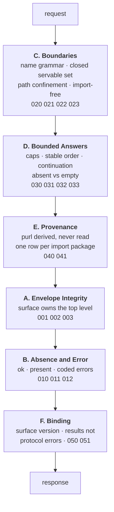

# Miri Standard: Surface Conformance (Consumption)

*Specification Version: 0.3.1-draft*
*Status: Draft*
*Created: 2026*

## Abstract

The [Discovery Contract](discovery-contract.md) places obligations on three programs: a consumer, a surface and a
harness-configuration generator. The [Consumer Conformance](consumer-conformance.md) profile numbers the obligations
that bind a **consumer** and states that it does not score the others. This document numbers the obligations that
bind a **surface**: **eighteen** checks running from `MIRI-SURFACE-001` through `MIRI-SURFACE-051`, weighted to 100,
that define what a conformant **metadata-query surface** is. The IDs are sparse and grouped in tens by category; the
range is an address space rather than a count. Neither profile scores the generator's four obligations
([Consumer Conformance §4](consumer-conformance.md)).

Without this profile, three of the contract's central guarantees would be normative prose with nothing verifying
them: the envelope cannot be forged, absence is distinguishable from failure, and discovery never executes an
unvetted package. A reference implementation could regress on every one and no check in this standard would fire.

## Table of Contents

1. [What This Document Is](#1-what-this-document-is)
2. [The Verification Model](#2-the-verification-model)
3. [Scoring Model](#3-scoring-model)
4. [The Checks](#4-the-checks)
5. [Why These Are Not Consumer Checks](#5-why-these-are-not-consumer-checks)
6. [Check Definitions](#6-check-definitions)

---

## 1. What This Document Is

A **surface** is any program that answers the [Discovery Contract §3](discovery-contract.md) operations: the MCP context
server that is the contract's first binding, and any future binding of the same operations over a different transport.
It sits between an installed environment and a consumer. Its job is narrow: read metadata, wrap it, relay it, and do
nothing else.

Most checks in this profile test that the surface refrains from something. A conformant surface does **not** execute the
package it is describing, fetch what the package's metadata points at, merge publisher bytes into its own namespace,
serve a document outside a closed set, or repair what it could not parse.

## 2. The Verification Model

A surface, unlike a consumer, has a **specified output**. Every operation's response shape is fixed by §4 of
the contract. Conformance can therefore be checked by issuing a request and inspecting the envelope that
comes back. The check involves no judgment about phrasing and no assertion on natural language.

Verification is a **driven suite**, like the consumer profile, but the assertions are exact:

1. Install a fixture from [`examples/fixtures/`](../../examples/fixtures/) into the environment the surface serves.
2. Issue a request, including the deliberately hostile ones a request-trace fixture supplies.
3. Assert on the returned envelope against the golden in `examples/fixtures/expected/`.

Goldens do the most work in this profile. A consumer assertion is necessarily partly about wording, while a surface
assertion is a structural comparison. Where a check below says a field MUST be present or absent, that is
mechanically decidable from one response.

## 3. Scoring Model

The scoring model is identical to the sibling profiles' model, and one grading vocabulary spans the standard:

- **Score** = Σ weights of passing checks, over the *effective denominator* (see forfeits below).
- **Level**: **M** (MUST: required for conformance) or **S** (SHOULD: quality signal).
- **Conformance is a gate rather than a band.** A program failing any **M** check is **non-conforming**, and a
  non-conforming result carries **no grade**. It carries only the score, capped at 74, to show distance. Grades describe
  conforming programs only.
- **Grade bands (conforming programs only)**: 90–100 **Gold** · 75–89 **Silver** · 50–74 **Bronze**.

**In 0.3-draft every check in this profile is a MUST, and all 100 weight is MUST weight. The bands above are
therefore unreachable: a conforming surface scores exactly 100, and a non-conforming one gets no grade at all.** This
section marks the bands unreachable so that no reader computes a Silver that can never occur. They exist for
vocabulary parity with the producer checklists and will become live the first time this profile gains a SHOULD.

Every obligation here is a MUST by design, because of what a metadata-query surface *is*. A surface has one job: to
answer queries in the shape this contract specifies. A consumer could not safely rely on any partial version of
that job. A surface that forges an envelope field, serves outside the closed set, or paginates unstably is unusable
rather than lower in quality.

`031` (ordering) and `033` (continuation) are MUST rather than SHOULD. The Discovery Contract states both as MUST, and
cursor correctness is *defined* in terms of stable ordering. A SHOULD enforcing a MUST would be a gap. A check that
scored cursor continuation while permitting the unstable ordering that makes continuation meaningless could pass a
surface whose cursors do not work.

**Forfeits.** A check whose fixture cannot be driven is **forfeited and reported, never silently passed**. A
forfeited check is **excluded from both** the numerator and the denominator. It is removed from the calculation and
is not counted as a failure. The score is computed over what was exercised, and forfeiting therefore cannot inflate
or deflate it. The report MUST carry the forfeited count and the effective denominator beside the score. A forfeited
**M** check means **conformance is undetermined**, and the report states it as undetermined, never as conforming and
never as a failure.

## 4. The Checks

The profile has eighteen checks, and their weights sum to 100. IDs are stable and are never renumbered. The figure
arranges the six categories along the path a request takes through a conformant surface:

The category letters follow the order of the tables below, and the figure follows the order of a request. That order
matters because a boundary failure admits bytes that the later categories then wrap and provenance-stamp faithfully. A
surface that serves a document outside the servable set has therefore already failed, however correct its envelope is.

### A. Envelope Integrity (20 points)

The surface owns the top level of every response. The whole anti-forgery argument rests on this category.

| ID | Level | Check | Weight | Case |
|---|---|---|---|---|
| MIRI-SURFACE-001 | M | Stamps `schema_version` (the string `"1"` in 0.3-draft) on every response | 6 | any |
| MIRI-SURFACE-002 | M | Nests the payload; never merges publisher bytes into the envelope | 8 | `adversarial` (A1/A2) |
| MIRI-SURFACE-003 | M | Emits only the keys reserved by Discovery Contract §4.1 at the top level | 6 | any |

### B. Absence and Error (22 points)

The contract calls this discrimination its single most consequential clause.

| ID | Level | Check | Weight | Case |
|---|---|---|---|---|
| MIRI-SURFACE-010 | M | Reports absence as `ok: true, present: false`, never as an error | 8 | `bare` |
| MIRI-SURFACE-011 | M | Reports failure as `ok: false` with a coded `error` object | 7 | `expected/requests.json` |
| MIRI-SURFACE-012 | M | Reports a document it cannot **parse** as `METADATA_UNREADABLE`, never absent or repaired | 7 | `malformed` |

### C. Boundaries (24 points)

Every check in this category is a refusal: it tests what the surface will not do.

| ID | Level | Check | Weight | Case |
|---|---|---|---|---|
| MIRI-SURFACE-020 | M | Serves only the closed servable set; refuses anything else | 8 | `expected/requests.json` |
| MIRI-SURFACE-021 | M | Confines the resolved path; rejects symlinks and traversal | 8 | `symlinked` |
| MIRI-SURFACE-022 | M | Discovers import-free; executes nothing | 5 | `hostile-import` |
| MIRI-SURFACE-023 | M | Fetches nothing: never resolves a URL found in a served document | 3 | `adversarial` (A7) |

### D. Bounded Answers (16 points)

| ID | Level | Check | Weight | Case |
|---|---|---|---|---|
| MIRI-SURFACE-030 | M | Declares and enforces its caps, and sets `truncated` when it drops content | 6 | `adversarial` (A4) |
| MIRI-SURFACE-031 | M | Orders entries stably across repeated requests | 2 | `adversarial` (A4) |
| MIRI-SURFACE-032 | M | Distinguishes an absent `api-index` from an empty one | 6 | `bare`, `miri` |
| MIRI-SURFACE-033 | M | Offers cursor continuation and rejects an out-of-scope cursor | 2 | `expected/cursor.json` |

### E. Provenance and Identity (11 points)

| ID | Level | Check | Weight | Case |
|---|---|---|---|---|
| MIRI-SURFACE-040 | M | Derives `purl` from the installed distribution; never reads it from a document | 6 | `spoofed` |
| MIRI-SURFACE-041 | M | Emits one row per import package; errors rather than picking among ambiguous ones | 5 | `ambiguous-a` + `ambiguous-b` (A12) |

### F. Binding (7 points)

| ID | Level | Check | Weight | Case |
|---|---|---|---|---|
| MIRI-SURFACE-050 | M | Advertises the surface version at its binding's normative path (for MCP, `capabilities.miri.surface_version` in `initialize`; Discovery Contract §6.3) | 4 | any |
| MIRI-SURFACE-051 | M | Carries absence and error as tool results, never as protocol errors | 3 | `bare`, `expected/requests.json` |

### Category Summary

| Category | Checks | Points |
|---|---|---|
| A. Envelope Integrity | 3 | 20 |
| B. Absence and Error | 3 | 22 |
| C. Boundaries | 4 | 24 |
| D. Bounded Answers | 4 | 16 |
| E. Provenance and Identity | 2 | 11 |
| F. Binding | 2 | 7 |
| **Total** | **18** | **100** |

**All eighteen checks have an executable case.** The cases use the `malformed` variant, the `symlinked` document,
the import canary, the `spoofed` identity document, the `consuming-project` declarations and the request-trace set.
`tools/validate_fixtures.py` asserts that each stays live.

`MIRI-SURFACE-041` (one row per import package, and `AMBIGUOUS_PACKAGE`) is a **MUST** that needs two distributions
providing one import name. Its case is `ambiguous-a` and `ambiguous-b`: two distributions that both provide
`greet_ambiguous`. The two share the template source, and the collision is therefore the only variable.

## 5. Why These Are Not Consumer Checks

It would be simpler to keep one profile. The split exists because the two programs fail differently, and a single
score would obscure which one is broken.

A consumer emits no responses and cannot be held to the shape of one. A surface makes no decisions about what to
call and cannot be held to the judgment a consumer exercises. Scoring them together would produce a number that
answers neither "can I trust this server" nor "can I trust this agent". When such a number dropped, it would not say
which program had failed.

The division follows the actor table in [Consumer Conformance §4](consumer-conformance.md). Every obligation marked
there as binding the **Surface** is numbered here, and every category in §4 appears in that table. Absence is the one
obligation named on both sides. A surface must *signal* it correctly and a consumer must *report* it correctly; these
are different failures, and either can occur without the other.

## 6. Check Definitions

The authoritative definition of each check is its YAML file in `standards/consumption/checks/`, governed by
`schemas/check-v3.json` with `target: surface`. The tables in §4 are the derived rendering. Where the two disagree,
the YAML is correct.

Surface and consumer checks share a directory because they share a suite and a contract; they are separated by
`target`, and their weights sum to 100 independently.
